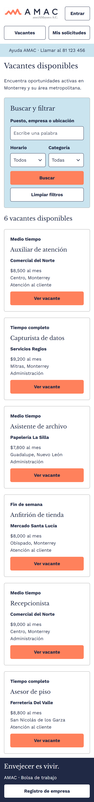
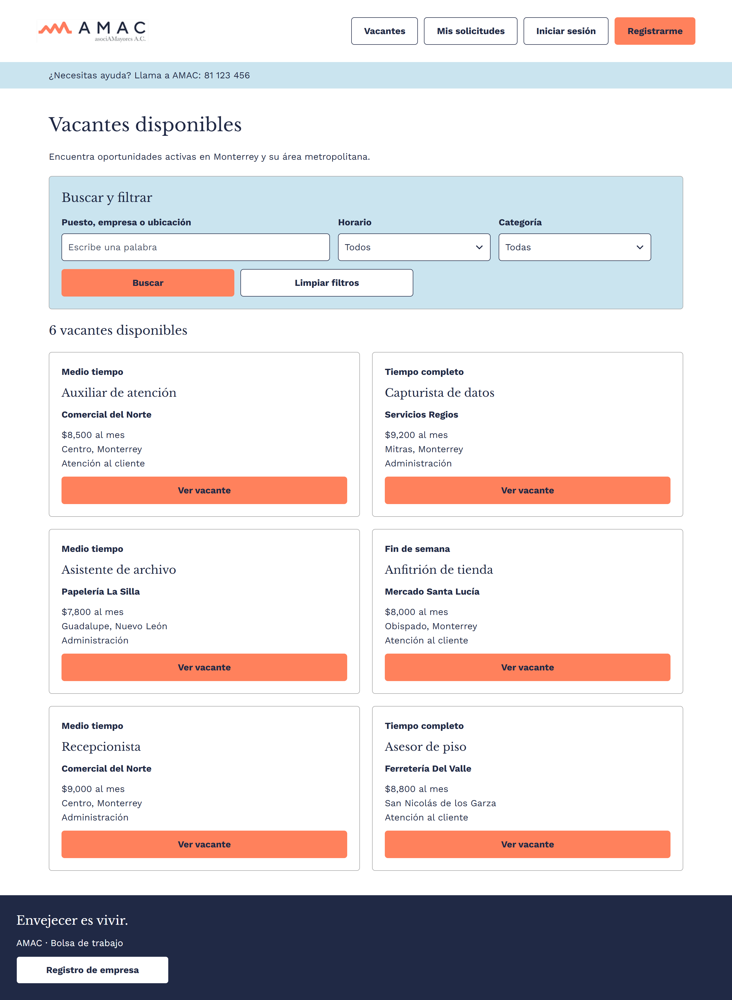
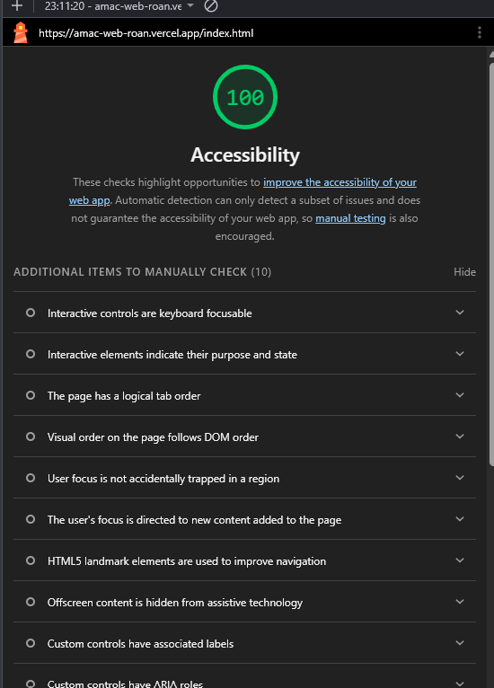

# AMAC - Bolsa de trabajo

Entrega 2 del proyecto final: maquetación en HTML semántico y CSS del prototipo de Figma, sin frameworks.

Sitio publicado: https://amac-web-roan.vercel.app  
Prototipo en Figma: https://www.figma.com/design/Jxpn1QILr1Nzjg5ZN2DkRX/Actividad-1-Proyecto

## Integrantes y aportación

Salvador Rodríguez Coronado: Creé el repositorio y la estructura inicial del proyecto. Pasé los estilos de Figma a variables CSS y escribí las cuatro hojas de estilo del sitio: variables.css, base.css, layout.css y componentes.css. También maqueté el flujo de Mis solicitudes (la lista de postulaciones, la confirmación para cancelar, la solicitud cancelada y la solicitud aceptada) y la página de error 404. Publiqué el sitio en Vercel y completé el README.

Mauricio López: Maqueté las páginas del candidato: el listado de vacantes con buscador y filtros, los resultados de búsqueda, el detalle de vacante con los botones "Postularme" y "Llamar", la vista para cuentas pendientes de aprobación, el inicio de sesión, el registro de candidato y el flujo de postulación hasta la confirmación de solicitud enviada. 

Axel Machorro: Maqueté las páginas de la empresa: el registro de empresa, el panel de vacantes, los formularios para publicar y editar vacantes, los estados de vacante publicada, pausada y cerrada con su confirmación de cierre, y la revisión de solicitudes recibidas con el detalle del candidato y la actualización de estatus. 

## Capturas

Así se ve la página de inicio en celular y en escritorio:

| Celular | Escritorio |
| --- | --- |
|  |  |

Puntaje de Lighthouse en accesibilidad para `index.html`:

## Colores y tipografía

Tomamos los colores y estilos de texto directamente de Figma y los guardamos como variables en `css/variables.css`, para poder reutilizarlos en todo el sitio.

Colores:

- `--color-navy` (#202945): texto, bordes de botones y pie de página.
- `--color-coral` (#ff815c): botón principal.
- `--color-cielo` (#cae4ef): franja de ayuda, avisos y etiquetas de estatus.
- `--color-arena` (#fddaad): avisos de cuenta en revisión y vacante pausada.
- `--color-gris` (#a8a8a8): bordes de tarjetas y botón inactivo.
- `--color-blanco` (#ffffff): fondo.

Revisamos el contraste del texto con el verificador de WebAIM y todas las combinaciones pasan el mínimo de 4.5:1.

Para los títulos usamos Libre Baskerville y para el texto Work Sans, las dos de Google Fonts, igual que en el prototipo. El texto base mide 18 px y los títulos van de 22 a 36 px. Todos los tamaños están en `rem`, para que el texto crezca si la persona agranda la letra del navegador.

## Componentes reutilizables

Estas son las piezas que se repiten en varias páginas. Cada una tiene su clase en `componentes.css` y pensamos convertirlas en componentes de React en la Entrega 3:

- Botón (`.boton`), con variantes primaria, secundaria, de peligro e inactiva.
- Tarjeta de vacante (`.tarjeta-vacante`).
- Tarjeta y avisos (`.tarjeta`, `.tarjeta--aviso`, `.tarjeta--alerta`).
- Etiqueta de estatus (`.etiqueta-estatus`): Pendiente, Aceptada, Rechazada, Activa, Pausada, Cerrada.
- Campo de formulario (`.campo-formulario`) y grupo de campos (`.grupo-campos`).
- Casilla de aceptación (`.casilla`).
- Lista de datos de una vacante o candidato (`.lista-datos`).
- Buscador con filtros (`.busqueda`).
- Encabezado, franja de ayuda y pie de página, que se repiten en todas las páginas.

## Cambios respecto al prototipo de Figma

Hicimos algunos ajustes al diseño original para cumplir con lo que pedía la entrega:

- En el listado agregamos dos vacantes (Recepcionista y Asesor de piso), porque Figma tenía 4 y se pedían al menos 6.
- La vacante de Anfitrión de tienda tiene un botón "Llamar", ya que en Figma ninguna vacante aceptaba postulaciones por teléfono.
- En Mis solicitudes agregamos una tercera solicitud con estatus "Aceptada", para mostrar tres estatus distintos.
- Los filtros dicen "Todos" y "Todas" en lugar de "Todos los horarios", porque el texto largo no cabía en celular.
- Las listas desplegables tienen una flecha para que se note que se pueden abrir.

## Páginas extra

Además de las 6 páginas obligatorias, maquetamos el registro de empresa, las solicitudes recibidas por la empresa y una página de error 404.

## Pruebas

Pasamos las páginas por el validador de W3C sin errores, revisamos el sitio en 320, 768, 1024 y 1440 px y con zoom al 200 %, y lo recorrimos usando solo el teclado.